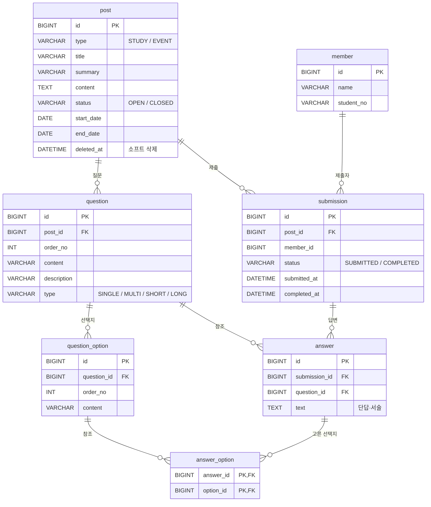

<div align="center">

# 📋 WINK 활동 신청 서버

**WINK 동아리 홈페이지의 스터디·행사 신청 기능 백엔드**


</div>

<br>

## 📖 목차

- [소개](#-소개)
- [기술 스택](#-기술-스택)
- [주요 기능](#-주요-기능)
- [패키지 구조](#-패키지-구조)
- [데이터 모델](#-데이터-모델)
- [실행 방법](#-실행-방법)
- [API](#-api)
- [남은 작업](#-남은-작업)

<br>

## 💡 소개

학기마다 구글폼으로 받던 스터디·행사 신청을 **사이트 안에서** 받을 수 있게 합니다.

- **운영진**은 신청글과 신청서 질문을 한 화면에서 만들어 게시하고, 제출자를 확인하고, 참여 완료를 처리하고, 제출 내역을 CSV로 내려받습니다.
- **부원**은 신청글을 보고 신청서를 제출·수정·취소합니다.

<br>

## 🛠 기술 스택

| 구분 | 사용 기술 |
|:--|:--|
| Language | Java 17+ |
| Framework | Spring Boot 4.x · Spring Web MVC · Bean Validation |
| Persistence | Spring Data JPA (Hibernate) · JdbcTemplate |
| Database | MySQL 8.0.16+ |
| Build | Gradle Wrapper |
| Etc | Lombok |

<br>

## ✨ 주요 기능

### 👑 운영진

| ID | 기능 | 설명 |
|:--|:--|:--|
| POST-01 | 신청글 작성 | 구분·제목·한 줄 소개·신청 기간·본문 + 신청서 질문을 함께 게시 |
| FORM-01 | 신청서 질문 구성 | `SINGLE` · `MULTI` · `SHORT` · `LONG` 4종, 질문 0개도 가능 |
| POST-02 | 신청글 수정 | 모집 중인 글만. 제출이 있으면 질문·선택지는 잠금 |
| POST-03 | 신청글 삭제 | 제출이 없는 글만 소프트 삭제 |
| POST-06 | 조기 마감 | 모집 중 → 마감 (한 방향) |
| POST-07 | 운영진 신청글 목록 | 상태 탭 · 종류 필터 · 제목 검색 · 글별 제출 인원 |
| FORM-03 | 제출자 목록 | 이름 · 학번 · 제출일 · 상태, 상태별 건수 |
| FORM-04 | 참여 완료 처리 | 제출됨 ↔ 참여 완료 |
| FORM-05 | CSV 내보내기 | 제출자 + 질문별 답변 (UTF-8 BOM) |
| FORM-06 | 제출 상세 | 한 부원의 질문별 답변 |

### 🙋 부원

| ID | 기능 | 설명 |
|:--|:--|:--|
| POST-04 | 신청글 목록 | 비로그인도 조회 가능, "모집 중인 글만 보기" |
| POST-05 | 신청글 상세 | 로그인하면 내 신청 여부 표시 |
| FORM-02 | 신청서 조회 | 질문·선택지, 이미 신청했다면 내 답변 |
| SUB-01 | 신청서 제출 | 신청글당 1인 1제출, 모든 질문은 선택 응답 |
| SUB-05 | 답변 수정 | 모집 중 + 참여 완료 전 |
| SUB-03 | 신청 취소 | 모집 중 + 참여 완료 전, 제출과 답변 삭제 |
| SUB-02 | 제출 검증 | 모집 중이 아닌 글의 제출·수정·취소 차단 |

### ⏰ 상태 규칙

> [!NOTE]
> - 신청 기간은 **일 단위**입니다. 시작일 0시부터 종료일 23:59:59(KST)까지 받습니다.
> - 상태는 `OPEN`(모집 중) / `CLOSED`(마감) 두 가지입니다. 종료일이 지나면 배치 없이 **조회할 때 마감으로 계산**합니다.
> - 시작일 전 글은 부원에게 보이지 않고 운영진 목록에만 보입니다.

<br>

## 📁 패키지 구조

```
com.wink.ichibang
├── global        # 모든 도메인이 함께 쓰는 공통 코드
│   ├── exception # ErrorCode · BusinessException · GlobalExceptionHandler · ErrorResponse
│   ├── response  # ApiResponse · PageResponse
│   └── time      # TimeZones (KST)
├── auth          # 로그인한 부원·운영진 확인 (현재는 임시 헤더 방식)
├── post          # 신청글 + 신청서 질문 (POST-01~07, FORM-01)
│   ├── controller · service · repository · domain · dto
│   └── port      # 제출 도메인에 묻는 창구 (SubmissionPort)
├── submission    # 신청서 제출·수정·취소 (SUB-01~03, 05)
└── form          # 신청서 조회, 제출자 관리 (FORM-02~06)
```

도메인끼리는 엔티티를 직접 참조하지 않고 **ID로만** 연결합니다. 신청글 도메인은 제출 수와 내 신청 정보를 `post.port.SubmissionPort`로만 묻고, 구현체(`SubmissionPortAdapter`)는 submission 도메인에 있습니다.

form 도메인도 제출·답변 테이블을 SQL로 직접 읽거나 고치지 않습니다. 읽기는 `SubmissionQueryService`, 상태 변경(참여 완료 처리)은 `SubmissionService.changeStatus`를 거치고, 상태 규칙은 `Submission` 엔티티(`complete()`, `revert()`)가 지킵니다.

<br>

## 🗂 데이터 모델



| 테이블 | 설명 |
|:--|:--|
| `member` | 회원. 제출자 관리에서 이름·학번을 표시할 때 사용 (**임시**) |
| `post` | 신청글. 수동 마감 여부, 기간, 소프트 삭제 |
| `question` | 신청서 질문. 유형, 설명, 표시 순서 |
| `question_option` | 객관식 선택지 (`option`이 MySQL 예약어라 이름 변경) |
| `submission` | 부원 1명이 신청글 1건에 낸 신청서. 취소하면 행 삭제 |
| `answer` | 질문 하나에 대한 답. 단답·서술은 `text` |
| `answer_option` | 객관식 답에서 고른 선택지 (MULTI는 여러 행) |

- 스키마: [`src/main/resources/db/migration/V1__init.sql`](src/main/resources/db/migration/V1__init.sql)

> [!NOTE]
> `member`는 로그인 기능이 붙기 전까지 쓰는 **임시 테이블**입니다. 제출자 관리(FORM-03·05·06)가 읽는 `id`, `name`, `student_no`만 있습니다.
> `submission.member_id`와는 외래키 없이 ID로만 연결합니다. 홈페지이 연동 확정 시 기존 회원 테이블로 바꿉니다.

<br>

## 🚀 실행 방법

### 1. 데이터베이스 준비

```sql
CREATE DATABASE ichibang DEFAULT CHARACTER SET utf8mb4;
CREATE USER 'wink'@'localhost' IDENTIFIED BY '<비밀번호>';
GRANT ALL PRIVILEGES ON ichibang.* TO 'wink'@'localhost';
```

이어서 `V1__init.sql`을 실행해 테이블을 만들고, 임시 회원 테이블과 테스트 회원을 추가합니다.

```sql
CREATE TABLE member (
    id          BIGINT       NOT NULL AUTO_INCREMENT,
    name        VARCHAR(50)  NOT NULL,
    student_no  VARCHAR(20)  NOT NULL,
    PRIMARY KEY (id)
) ENGINE = InnoDB DEFAULT CHARSET = utf8mb4;

INSERT INTO member (id, name, student_no) VALUES
  (1,  '운영진', '20210001'),
  (10, '홍길동', '20241234');
```

> [!TIP]
> Ubuntu의 MySQL `root`는 auth_socket 인증이라 애플리케이션에서 접속할 수 없습니다. 위처럼 전용 계정을 만들어 주세요.

### 2. 로컬 설정 파일

`src/main/resources/application-local.yml`

```yaml
spring:
  datasource:
    url: jdbc:mysql://localhost:3306/ichibang?serverTimezone=Asia/Seoul
    username: wink
    password: <비밀번호>
  jpa:
    hibernate:
      ddl-auto: validate
```

> [!WARNING]
> 비밀번호가 들어가는 파일이므로 **커밋하지 않습니다.** (`.gitignore`에 포함)

### 3. 서버 실행

```bash
./gradlew bootRun --args='--spring.profiles.active=local'
```

IntelliJ에서는 Run Configuration의 **Active profiles**에 `local`을 넣고 실행합니다.

<br>

## 🔌 API

### 응답 형식

<details>
<summary>성공 응답</summary>

```json
{
  "data": { "id": 1, "status": "OPEN" }
}
```

</details>

<details>
<summary>오류 응답</summary>

```json
{
  "errorCode": "VALIDATION_FAILED",
  "message": "필수 항목을 입력해주세요",
  "fieldErrors": [
    { "field": "questions[0].options", "reason": "객관식 질문마다 선택지를 1개 이상 추가해주세요" }
  ]
}
```

</details>

### 엔드포인트

#### 🌐 누구나

| Method | URL | 기능 |
|:--|:--|:--|
| `GET` | `/api/posts?recruiting&type&page&size` | POST-04 신청글 목록 |
| `GET` | `/api/posts/{postId}` | POST-05 신청글 상세 |

#### 🔑 로그인

| Method | URL | 기능 |
|:--|:--|:--|
| `GET` | `/api/posts/{postId}/form` | FORM-02 신청서 조회 |
| `POST` | `/api/posts/{postId}/submissions` | SUB-01 신청서 제출 |
| `PUT` | `/api/posts/{postId}/submissions/me` | SUB-05 답변 수정 |
| `DELETE` | `/api/posts/{postId}/submissions/me` | SUB-03 신청 취소 |

#### 👑 운영진

| Method | URL | 기능 |
|:--|:--|:--|
| `POST` | `/api/admin/posts` | POST-01 신청글 작성 |
| `GET` | `/api/admin/posts?status&type&keyword&page&size` | POST-07 운영진 목록 |
| `GET` | `/api/admin/posts/{postId}` | POST-02 수정용 조회 |
| `PUT` | `/api/admin/posts/{postId}` | POST-02 신청글 수정 |
| `DELETE` | `/api/admin/posts/{postId}` | POST-03 신청글 삭제 |
| `POST` | `/api/admin/posts/{postId}/close` | POST-06 조기 마감 |
| `GET` | `/api/admin/posts/{postId}/submissions?status&page&size` | FORM-03 제출자 목록 |
| `GET` | `/api/admin/posts/{postId}/submissions/{submissionId}` | FORM-06 제출 상세 |
| `PATCH` | `/api/admin/posts/{postId}/submissions/{submissionId}/status` | FORM-04 참여 완료 처리 |
| `GET` | `/api/admin/posts/{postId}/submissions/export.csv` | FORM-05 CSV 내보내기 |

요청·응답 필드와 오류 코드는 기능 명세서(`WINK 기능별 상세 v4`)를 따릅니다.

### 임시 인증 (로그인 연동 전)

> [!IMPORTANT]
> 로그인 기능이 붙기 전까지 **요청 헤더**로 로그인한 사용자를 흉내 냅니다.

| 헤더 | 값 | 용도 |
|:--|:--|:--|
| `X-Member-Id` | 회원 ID (예: `10`) | 로그인한 부원. 없으면 `401` |
| `X-Member-Role` | `ADMIN` | 운영진. `/api/admin/**`에서 없으면 `403` |

로그인이 연동되면 `auth/CurrentMember`와 각 컨트롤러의 헤더 읽는 부분만 교체합니다.

<details>
<summary>예시: 신청글 작성 요청</summary>

```http
POST /api/admin/posts
X-Member-Id: 1
X-Member-Role: ADMIN
Content-Type: application/json
```

```json
{
  "type": "STUDY",
  "title": "Spring Boot 챌린지",
  "summary": "기초부터 함께 만드는 나의 첫 백엔드 서비스",
  "startDate": "2026-11-20",
  "endDate": "2026-11-30",
  "content": "8주 동안 Spring Boot로 나만의 백엔드 서비스를 만들어 봅니다.",
  "questions": [
    { "content": "현재 학년을 선택해주세요", "type": "SINGLE", "options": ["1학년", "2학년", "3학년", "4학년"] },
    { "content": "참여 가능한 시간대를 모두 골라주세요", "type": "MULTI", "options": ["평일 저녁", "주말 오전", "주말 오후"] },
    { "content": "GitHub 주소를 알려주세요", "type": "SHORT" }
  ]
}
```

</details>

<br>

## 📝 남은 작업

- [ ] COM-01 로그인 연동 (기존 로그인 방식 확인 후 임시 헤더 인증 교체)
- [ ] SUB-04 MY 신청 목록 `GET /api/submissions/me`
- [ ] 임시 `member` 테이블을 로그인 담당의 회원 테이블로 교체
- [x] 공통 응답·오류 처리(global) 패키지로 도메인별 예외 핸들러 통합
- [ ] 명세의 "확인 필요" 항목 확정 (구분 변경 허용 여부, 단답·서술 글자 수 제한 등)
